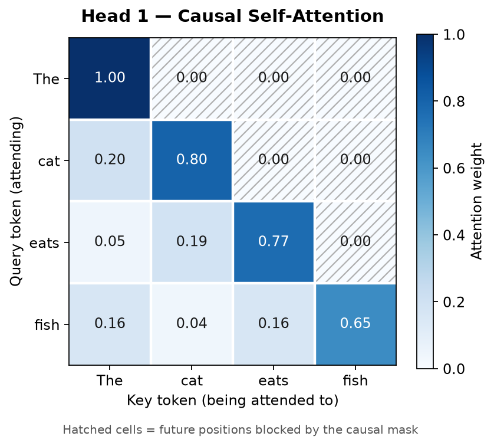
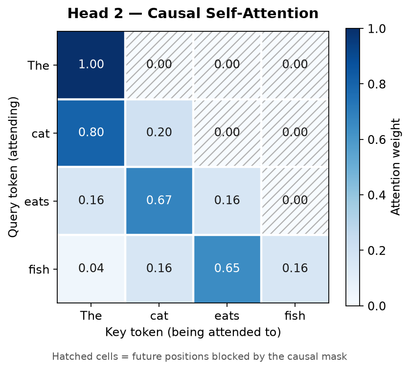
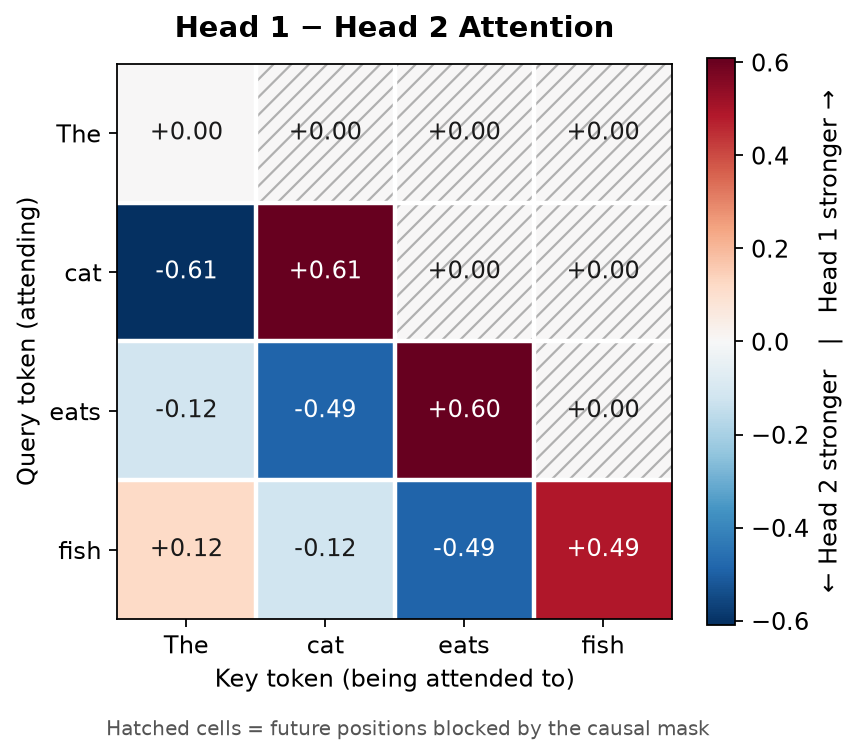
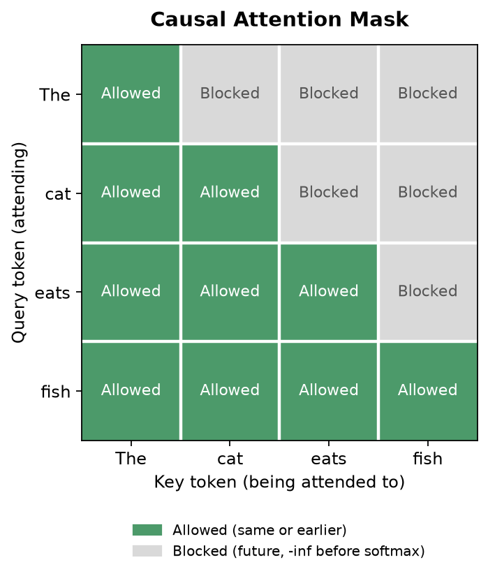

# attention-from-scratch
Implementing transformer attention from scratch using Python and PyTorch, from dot products to multi-head attention.

## Project purpose

An educational project to understand transformer attention both mathematically
and in code. Each milestone adds one small idea on top of the previous one.

## Milestone 1 — Dot-product similarity

**Objective:** compute token-to-token similarity using the dot product in two ways:

1. Manually, with nested Python loops.
2. With PyTorch matrix multiplication: `embeddings @ embeddings.T`.

Both approaches must produce the same score matrix.

Input (hand-picked embeddings for learning, not from a trained model):

```python
tokens = ["cat", "eats", "fish"]
embeddings = torch.tensor([
    [1.0, 0.0],  # cat
    [0.0, 1.0],  # eats
    [1.0, 1.0],  # fish
])
```

## Installation

```bash
python3 -m venv .venv
source .venv/bin/activate
pip install -r requirements.txt
```

## Run

```bash
python src/dot_product.py
```

## Expected output

```
=== Embeddings ===
tensor([[1., 0.],
        [0., 1.],
        [1., 1.]])
Embedding shape: (3, 2)

=== Transposed embeddings (embeddings.T) ===
tensor([[1., 0., 1.],
        [0., 1., 1.]])
Transposed shape: (2, 3)

=== Manual scores (nested Python loops) ===
[1.0, 0.0, 1.0]
[0.0, 1.0, 1.0]
[1.0, 1.0, 2.0]

=== PyTorch scores (embeddings @ embeddings.T) ===
tensor([[1., 0., 1.],
        [0., 1., 1.],
        [1., 1., 2.]])
Score shape: (3, 3)

=== Token-to-token similarity table ===
             cat    eats    fish
cat          1.0     0.0     1.0
eats         0.0     1.0     1.0
fish         1.0     1.0     2.0

=== Verification ===
Manual and PyTorch results match: True
Results match expected values:   True
All checks passed.
```

## Matrix shapes explained

| Tensor | Shape | Meaning |
|---|---|---|
| `embeddings` | (3, 2) | 3 tokens, each a 2-dimensional vector |
| `embeddings.T` | (2, 3) | Transpose: rows and columns swapped, so each token is now a column |
| `scores` | (3, 3) | One similarity score for every (token, token) pair |

Matrix multiplication `(3, 2) @ (2, 3)` works because the inner dimensions match
(2 = 2). The result takes the outer dimensions, giving `(3, 3)`.

Each entry `scores[i][j]` is the dot product of token `i`'s embedding with token
`j`'s embedding. For example:

```
fish · fish = (1 * 1) + (1 * 1) = 2
cat  · eats = (1 * 0) + (0 * 1) = 0
```

- **Row i:** how token `i` compares to every token.
- **Column j:** how every token compares to token `j`.
- The matrix is symmetric because `a · b == b · a`.

## Raw dot-product similarity vs. transformer attention

This milestone computes **raw** similarity only. Real transformer attention adds
several steps on top of it, which later milestones will cover:

- **Q, K, V projections:** the embeddings are first multiplied by learned weight
  matrices to produce queries, keys and values. Scores are `Q @ K.T`, not
  `embeddings @ embeddings.T`, so the matrix is generally not symmetric.
- **Scaling:** scores are divided by `sqrt(d_k)` to keep them from growing too large.
- **Softmax:** each row is turned into weights that are positive and sum to 1.
- **Weighted sum of values:** those weights are used to mix the value vectors
  into a new, context-aware representation of each token.
- **Masking and multiple heads:** decoders hide future tokens, and multi-head
  attention runs several attention computations in parallel.

Raw dot products are unnormalized. Longer vectors produce bigger scores, which is
why "fish" scores 2 with itself while "cat" scores 1.

---

## Milestone 2 — Scaled dot-product attention

**Objective:** understand how raw similarity scores become attention weights,
and how those weights combine value vectors into contextual representations.

```
Attention(Q, K, V) = softmax( Q @ K.T / sqrt(d_k) ) @ V
```

> **Note:** M2 uses `Q = K = V = embeddings` to keep the focus on the attention
> math. In a real transformer, Q, K and V come from separate learned projection
> matrices. Those are introduced in M3.

### Each operation

| Step | Code | What it does |
|---|---|---|
| Q, K, V | `Q = K = V = embeddings` | **Query:** what a token looks for. **Key:** what a token offers to be matched against. **Value:** the information a token passes along. |
| Raw scores | `Q @ K.T` | Dot product of every query with every key: how well they match. |
| Scaling | `raw_scores / sqrt(d_k)` | `d_k = K.shape[-1]` is the key length. Dot products grow with `d_k`, so dividing keeps the logits in a moderate range. Every value changes, but the shape doesn't. |
| Softmax | `torch.softmax(scaled, dim=-1)` | Turns each row into positive weights that sum to 1. `dim=-1` (the last dimension) normalizes across the columns of each row, so each query gets its own distribution over keys. |
| Weighted sum | `attention_weights @ V` | Each output row is a blend of all value vectors, weighted by attention. |

**Numerically stable softmax.** The script also implements softmax by hand.
It subtracts each row's maximum before calling `exp()`, so the largest exponent
is `exp(0) = 1` and nothing can overflow. The result is unchanged because
`exp(x - m) / Σ exp(x - m) = exp(x) / Σ exp(x)`: the common factor `exp(-m)` cancels.

### Tensor shapes

| Tensor | Shape | Meaning |
|---|---|---|
| `Q`, `K`, `V` | (3, 2) | 3 tokens × 2 dimensions |
| `K.T` | (2, 3) | Keys as columns |
| `raw_scores`, `scaled_scores` | (3, 3) | One score per (query, key) pair |
| `attention_weights` | (3, 3) | Row i = how query i distributes its attention over the 3 keys |
| `output` | (3, 2) | `(3, 3) @ (3, 2)`: one new 2-dim vector per token |

### Run

```bash
python src/scaled_attention.py
```

### Expected results

Scaled scores (`d_k = 2`, `sqrt(d_k) ≈ 1.4142`):

```
[[0.7071, 0.0000, 0.7071],
 [0.0000, 0.7071, 0.7071],
 [0.7071, 0.7071, 1.4142]]
```

Attention weights (each row sums to 1; manual and PyTorch softmax match):

```
             cat    eats    fish
cat       0.4011  0.1978  0.4011
eats      0.1978  0.4011  0.4011
fish      0.2483  0.2483  0.5035
```

Contextual output:

```
[[0.8022, 0.5989],   # cat
 [0.5989, 0.8022],   # eats
 [0.7517, 0.7517]]   # fish
```

For example, the new vector for "cat" is

```
0.4011 * [1, 0] + 0.1978 * [0, 1] + 0.4011 * [1, 1] = [0.8022, 0.5989]
```

"cat" started as `[1, 0]`. After attention it has picked up some of the second
dimension from "eats" and "fish". That blending is what makes the representation
*contextual*.

### Scaling experiment

| | Largest weight per row (cat, eats, fish) |
|---|---|
| `softmax(Q @ K.T)` (unscaled) | 0.4223, 0.4223, 0.5761 |
| `softmax(Q @ K.T / sqrt(2))` (scaled) | 0.4011, 0.4011, 0.5035 |

Without scaling, the distributions are somewhat more concentrated on the top
score. With `d_k = 2` the difference is mild. Scaling matters much more when
`d_k` is large (e.g. 64 or 128). There, raw dot products can get big enough to
push softmax toward a near one-hot output with very small gradients.

### What M2 does and does not implement

**Does:** raw scores, scaling by `sqrt(d_k)`, manual stable softmax, PyTorch
softmax, weighted sum of values, scaling comparison, and shape and value assertions.

**Does not (future milestones):** learned Q/K/V projections (M3), multi-head
attention, causal masking, positional encoding, training, transformer blocks,
visualization.

---

## Milestone 3 — Query, Key, and Value projections

**Objective:** give Q, K and V their own projection matrices instead of using
the raw embeddings, and see how each projection affects attention.

```
Q = X @ W_Q
K = X @ W_K
V = X @ W_V
Attention(Q, K, V) = softmax( Q @ K.T / sqrt(d_k) ) @ V
```

### The purpose of Q, K and V

- **Query (`W_Q`):** what each token is *looking for*.
- **Key (`W_K`):** what each token *offers* to be matched against.
- **Value (`W_V`):** the information each token *passes along* once attended to.

Queries and keys decide **where** attention goes (the weights). Values decide
**what** information gets mixed (the output).

### Why projection matrices are normally learned

In a trained transformer, `W_Q`, `W_K` and `W_V` are learned parameters.
Training adjusts them so that useful queries match useful keys and values carry
useful information. In M3 they are **hand-picked** so the arithmetic is easy to
follow. There is no training here.

### Projection matrices used

| Matrix | Values | Effect on a row `[a, b]` |
|---|---|---|
| `W_Q` | `[[0, 1], [1, 0]]` | `[b, a]` (swap: each token looks for the *other* feature) |
| `W_K` | `[[0, 1], [-1, 2]]` | `[-b, a + 2b]` |
| `W_V` | `[[2, 0], [0, 0.5]]` | `[2a, 0.5b]` (stretch feature 1, shrink feature 2) |

### Tensor shapes

| Tensor | Shape | Why |
|---|---|---|
| `X` | (3, 2) | 3 tokens × 2 dimensions |
| `W_Q`, `W_K`, `W_V` | (2, 2) | Map a 2-dim embedding to a 2-dim vector |
| `Q`, `K`, `V` | (3, 2) | `(3, 2) @ (2, 2)`: inner dims match, so we keep 3 rows × 2 columns |
| `raw_scores`, `scaled_scores` | (3, 3) | `Q @ K.T` = `(3, 2) @ (2, 3)` |
| `attention_weights` | (3, 3) | Softmax doesn't change the shape |
| `output` | (3, 2) | `(3, 3) @ (3, 2)` |

### Run

```bash
python src/qkv_attention.py
```

### Results

```
Q = [[0, 1], [1, 0], [1, 1]]      K = [[0, 1], [-1, 2], [-1, 3]]
V = [[2, 0], [0, 0.5], [2, 0.5]]

Raw scores Q @ K.T:
[[ 1,  2,  3],
 [ 0, -1, -1],
 [ 1,  1,  2]]

Attention weights:
             cat    eats    fish
cat       0.1400  0.2840  0.5760     -> cat attends most to fish
eats      0.5035  0.2483  0.2483     -> eats attends most to cat
fish      0.2483  0.2483  0.5035     -> fish attends most to fish

Output:
[[1.4320, 0.4300],
 [1.5035, 0.2483],
 [1.5035, 0.3759]]
```

Each output row is a weighted sum of value vectors. For example, "cat":
`0.1400 * [2, 0] + 0.2840 * [0, 0.5] + 0.5760 * [2, 0.5] = [1.4320, 0.4300]`.

### Comparison with M2 (Q = K = V = X)

| | M2 baseline | M3 with projections |
|---|---|---|
| Raw scores | `[[1,0,1],[0,1,1],[1,1,2]]` | `[[1,2,3],[0,-1,-1],[1,1,2]]` |
| Symmetric? | Yes | **No** |
| cat attends most to | cat / fish (tie, 0.4011) | fish (0.5760) |
| eats attends most to | eats / fish (tie, 0.4011) | cat (0.5035) |
| Output for cat | `[0.8022, 0.5989]` | `[1.4320, 0.4300]` |

In M2, `Q = K`, so `score(i, j) = score(j, i)`. With separate projections that
symmetry breaks. Here "cat" scores 2 against "eats", but "eats" scores only 0
against "cat". How much token A attends to B no longer has to equal how much B
attends to A.

### Experiment A: change only `W_Q`

`W_Q` was changed from the swap to the identity `[[1, 0], [0, 1]]`. `W_K` and `W_V` stay the same.

| | Original | Modified `W_Q` |
|---|---|---|
| cat attends most to | fish (0.5760) | **cat** (0.5035) |
| eats attends most to | cat (0.5035) | **fish** (0.5760) |
| fish attends most to | fish (0.5035) | fish (0.5035) |
| Output | `[[1.4320,0.4300],[1.5035,0.2483],[1.5035,0.3759]]` | `[[1.5035,0.2483],[1.4320,0.4300],[1.5035,0.3759]]` |

Changing the queries changes what each token is looking for. The same keys then
match differently, so attention shifts to different tokens. "fish" is
unaffected because its embedding `[1, 1]` is unchanged by a swap, so its query
is identical in both cases.

### Experiment B: change only `W_V`

`W_V` was changed from `[[2, 0], [0, 0.5]]` to `[[0.5, 0], [0, 2]]`. `W_Q` and `W_K` are the originals.

- Raw scores: **unchanged**
- Attention weights: **unchanged**
- Output: **changed**, from `[[1.4320, 0.4300], ...]` to `[[0.3580, 1.7199], ...]`

Scores only use Q and K, so values have no say in *where* attention goes. Values
only control *what* gets mixed. Same weights, different ingredients, different output.

### What M3 does and does not implement

**Does:** hand-picked `W_Q`, `W_K` and `W_V`; scaled dot-product attention on the
projected Q/K/V; comparison with the M2 baseline; the two projection experiments;
and shape and value assertions.

**Does not:** multi-head attention, causal masking, positional encoding,
backpropagation or training, transformer blocks, visualization.

---

## M4 — Causal Masking

**Objective:** implement causal (masked) self-attention and verify that future
tokens cannot leak information into earlier token representations.

### What causal masking is, and why GPT uses it

GPT-style (autoregressive) transformers generate text one token at a time, left
to right. When the model builds the representation for position `i`, it must only
use positions `0..i`. Otherwise during training it could "cheat" by peeking at
the very token it is supposed to predict. A **causal mask** blocks every future
position.

```
scores         = Q @ K.T / sqrt(d_k)
masked_scores  = scores.masked_fill(~causal_mask, -inf)
causal_weights = softmax(masked_scores, dim=-1)
causal_output  = causal_weights @ V
```

### Inputs

| Token | Position | Embedding |
|---|---|---|
| The | 0 | `[0.5, 0.5]` |
| cat | 1 | `[1.0, 0.0]` |
| eats | 2 | `[0.0, 1.0]` |
| fish | 3 | `[1.0, 1.0]` |

These are hand-picked educational vectors, not trained embeddings. "cat", "eats"
and "fish" reuse the M1–M3 values. The projection matrices `W_Q`, `W_K` and `W_V`
are the same fixed M3 matrices.

### The lower-triangular mask

```python
causal_mask = torch.tril(torch.ones(seq_len, seq_len, dtype=torch.bool))
```

```
             The     cat    eats    fish     allowed keys
The         True   False   False   False     The
cat         True    True   False   False     The, cat
eats        True    True    True   False     The, cat, eats
fish        True    True    True    True     The, cat, eats, fish
```

- **Rows** = query positions. **Columns** = key positions.
- `True` = attention allowed. `False` = attention blocked.
- Each token can attend to itself and every earlier token, never to a later one.

### Why mask before softmax, and why `-inf`

Softmax computes `exp(score) / Σ exp(score)`. Since `exp(-inf) = 0`, a blocked
position contributes **exactly zero** to both the numerator and the sum. The
allowed positions then share all of the probability, so each row still sums to 1.

If we instead zeroed the weights *after* softmax, the rows would no longer sum
to 1 and would need re-normalizing. Masking the scores first gets this right
automatically.

### Unmasked vs causal attention weights

```
Unmasked                                  Causal
          The    cat   eats   fish                  The    cat   eats   fish
The     0.226  0.226  0.226  0.322        The     1.000  0.000  0.000  0.000
cat     0.166  0.117  0.237  0.480        cat     0.588  0.413  0.000  0.000
eats    0.261  0.372  0.183  0.183        eats    0.320  0.456  0.225  0.000
fish    0.199  0.199  0.199  0.403        fish    0.199  0.199  0.199  0.403
```

| Token | Unmasked output | Causal output |
|---|---|---|
| The | `[1.3219, 0.3305]` | `[1.0000, 0.2500]` (its own value only) |
| cat | `[1.3602, 0.4001]` | `[1.4125, 0.1469]` |
| eats | `[1.3720, 0.2487]` | `[1.2309, 0.1923]` |
| fish | `[1.4034, 0.3508]` | `[1.4034, 0.3508]` (identical) |

In the unmasked version, "cat" puts 48% of its attention on "fish", a token that
hasn't appeared yet. The causal version spreads that attention over "The" and
"cat" instead. "The" can only see itself, so its output is exactly its own value
vector. "fish" is last, so it sees the full sequence either way and its output is
unchanged.

### Future-token leakage experiment

Only the last token's embedding is changed, from "fish" `[1, 1]` to `[3, 0]`. The
projections, the mask and the earlier embeddings stay the same.

| Token | Causal: before → after | Unmasked: before → after |
|---|---|---|
| The | `[1.0000, 0.2500]` → `[1.0000, 0.2500]` **unchanged** | `[1.3219, 0.3305]` → `[3.0168, 0.1492]` changed |
| cat | `[1.4125, 0.1469]` → `[1.4125, 0.1469]` **unchanged** | `[1.3602, 0.4001]` → `[3.2810, 0.1600]` changed |
| eats | `[1.2309, 0.1923]` → `[1.2309, 0.1923]` **unchanged** | `[1.3720, 0.2487]` → `[2.7235, 0.1321]` changed |
| fish | `[1.4034, 0.3508]` → `[5.1629, 0.0598]` changed | `[1.4034, 0.3508]` → `[5.1629, 0.0598]` changed |

Without a mask, changing the last token rewrites the representations of every
earlier token, because information flows backward from the future. With the
causal mask, the first three outputs are bit-for-bit unaffected. Their weights
on "fish" are exactly zero, so neither fish's key (which affects scores) nor
its value (which affects outputs) can reach them. That is the guarantee
autoregressive models depend on.

### Tensor shapes

| Tensor | Shape |
|---|---|
| `X` | (4, 2) |
| `W_Q`, `W_K`, `W_V` | (2, 2) |
| `Q`, `K`, `V` | (4, 2) |
| scores / masked scores | (4, 4) |
| `causal_mask` | (4, 4), bool |
| attention weights | (4, 4) |
| output | (4, 2) |

### Run

```bash
python src/causal_attention.py
```

### Verification

The script ends with `All checks passed.` after asserting:

- **Shapes:** input, Q, K, V, scores, mask and output.
- **Mask structure:** the mask is lower triangular, every diagonal entry is `True`, and every future entry is `False`.
- **Causal weights:** every row sums to 1, no weight is negative, every future position has *exactly* zero weight, and "The" attends to itself with weight 1.
- **Leakage:** changing the last token leaves the first three causal outputs unchanged but changes earlier unmasked outputs.
- **Difference:** causal and unmasked outputs differ.

### Out of scope for M4

Multi-head attention, positional encoding, transformer blocks, feed-forward
layers, layer normalization, training, token generation, visualization.

---

## M5 — Multi-Head Attention

**Objective:** run several causal attention heads in parallel on the same input,
concatenate their outputs, and mix them with a final output projection `W_O`.

```
head_h       = softmax( Q_h @ K_h.T / sqrt(d_k) + M ) @ V_h     (M = causal mask: 0 or -inf)
concatenated = [head_1 | head_2]
final_output = concatenated @ W_O
```

### What multi-head attention is, and why transformers use it

A single head produces one attention pattern per token. With several heads, each
with its own `W_Q`, `W_K` and `W_V`, the model can compute several different
patterns at once over the same input. For example, one head may focus on the
token itself while another focuses on the previous token. Each head also carries
different value information. Running heads on small `d_k`-dimensional slices
costs about the same as one big head.

> In M5 the two patterns below are **built in by hand** so they're easy to see.
> Nothing was learned, and the heads carry no real linguistic meaning.

### Architecture

| Setting | Value |
|---|---|
| Tokens | The, cat, eats, fish |
| Sequence length | 4 |
| Model dimension | 4 |
| Heads | 2 |
| `d_k` = `d_v` per head | 2 |
| Causal mask | Enabled, the same mask applied inside each head |

The input `X` is the 4×4 identity (one-hot embeddings). This means `X @ W = W`,
so **row i of each projection matrix is token i's query/key/value vector**.

| Matrix | Rows (The, cat, eats, fish) | Purpose |
|---|---|---|
| `W_Q1` | `[2,0] [0,2] [-2,0] [0,-2]` | Head 1: each query points at its own key… |
| `W_K1` | `[1,0] [0,1] [-1,0] [0,-1]` | …so each token favors **itself** |
| `W_V1` | `[1,0] [0,1] [1,1] [0,2]` | Head 1 values |
| `W_Q2` | `[0,2] [0,2] [-2,0] [0,-2]` | Head 2: each query points at the previous token's key… |
| `W_K2` | `[0,1] [-1,0] [0,-1] [1,0]` | …so each token favors the **previous token** |
| `W_V2` | `[0,2] [1,0] [2,0] [1,1]` | Head 2 values |

```
W_O = [[1, 0,  1,  0],     final = [h1_a + h2_a,  h1_b + h2_b,  h1_a - h2_a,  h1_b - h2_b]
       [0, 1,  0,  1],
       [1, 0, -1,  0],
       [0, 1,  0, -1]]
```

### Tensor shapes

| Component | Shape |
|---|---|
| Input `X` | (4, 4) |
| `W_Q`, `W_K`, `W_V` per head | (4, 2) |
| Q, K, V per head | (4, 2) |
| Scores per head | (4, 4) |
| Attention weights per head | (4, 4) |
| Output per head | (4, 2) |
| Concatenated output | (4, 4) |
| `W_O` | (4, 4) |
| Final output | (4, 4) |

### How each head calculates attention

Each head does exactly what M4 did, with its own matrices:

1. `Q = X @ W_Q`, `K = X @ W_K`, `V = X @ W_V`, giving shape (4, 2).
2. `scores = Q @ K.T / sqrt(2)`, giving shape (4, 4).
3. Future positions are set to `-inf`. Every head has its own score matrix, so
   the mask must be applied inside every head. One head without a mask would
   leak future information into the result.
4. `softmax(..., dim=-1)` gives the attention weights. Future weights are exactly 0.
5. `weights @ V` gives the head output, shape (4, 2).

### Attention-weight comparison

```
Head 1 (favors self)                      Head 2 (favors previous token)
          The    cat   eats   fish                  The    cat   eats   fish
The     1.000  0.000  0.000  0.000        The     1.000  0.000  0.000  0.000
cat     0.196  0.804  0.000  0.000        cat     0.804  0.196  0.000  0.000
eats    0.045  0.187  0.768  0.000        eats    0.164  0.673  0.164  0.000
fish    0.157  0.038  0.157  0.647        fish    0.038  0.157  0.647  0.157
```

| Token | Head 1 attends most to | Head 2 attends most to |
|---|---|---|
| The | The | The (the only option) |
| cat | cat | The |
| eats | eats | cat |
| fish | fish | eats |

The input is the same. Only the projection matrices differ, and that alone
gives a completely different attention pattern.

### Why concatenate, and the role of `W_O`

`torch.cat([head1_output, head2_output], dim=-1)` puts the two (4, 2) outputs
side by side to make (4, 4). Columns 0–1 are head 1's features and columns 2–3
are head 2's. Nothing is added or averaged at this stage, so each head's
information stays separate.

`W_O` then mixes those features. Each final feature here is a sum or difference
of one head-1 feature and one head-2 feature. In a trained transformer `W_O` is
learned, and it decides how to combine what the heads found.

```
Concatenated [head1 | head2]             Final output (concatenated @ W_O)
The   [1.0000, 0.0000, 0.0000, 2.0000]   [1.0000, 2.0000,  1.0000, -2.0000]
cat   [0.1956, 0.8044, 0.1956, 1.6089]   [0.3911, 2.4133,  0.0000, -0.8044]
eats  [0.8133, 0.9546, 1.0000, 0.3272]   [1.8133, 1.2818, -0.1867,  0.6275]
fish  [0.3146, 1.4898, 1.6089, 0.2338]   [1.9235, 1.7236, -1.2942,  1.2560]
```

### Experiment A: change only `W_V1`

The columns of `W_V1` are swapped. Everything else is unchanged.

| Quantity | Changed? |
|---|---|
| Head 1 scores | No |
| Head 1 weights | No |
| Head 1 output | **Yes**, e.g. "The" `[1, 0]` → `[0, 1]` |
| Head 2 weights | No |
| Head 2 output | No |
| Concatenated output | **Yes**, columns 0–1 only |
| Final output | **Yes**, every row, e.g. "The" `[1, 2, 1, -2]` → `[0, 3, 0, -1]` |

Values never enter the score calculation, so they can't move the attention
distribution. They only change *what information* is carried along it. Heads are
independent, so head 2 is unaffected. `W_O` then spreads head 1's change across
every final feature.

### Experiment B: future-token leakage

Only the "fish" embedding is changed, from `[0, 0, 0, 1]` to `[1, 1, 1, 1]`.

| Row | Head 1 | Head 2 | Concatenated | Final output |
|---|---|---|---|---|
| The | unchanged | unchanged | unchanged | unchanged |
| cat | unchanged | unchanged | unchanged | unchanged |
| eats | unchanged | unchanged | unchanged | unchanged |
| fish | changed | changed | changed | changed |

Causal masking survives concatenation and the output projection for two reasons:

- Each head's mask already gives "fish" zero weight in every earlier row.
- Both concatenation and `@ W_O` act on **one token's row at a time**. `W_O` mixes
  features within a row, never across sequence positions. So there is no path
  for row 3 to reach rows 0–2.

### Run

```bash
python src/multi_head_attention.py
```

### Verification

The script ends with `All checks passed.` after asserting:

- **Shapes:** every shape in the table above.
- **Weights:** every row sums to 1, no weight is negative, every future weight is *exactly* 0, and "The" attends only to itself. These are checked for all six head runs.
- **Heads differ:** the two heads have different weights.
- **Experiment A:** `W_V1` changes head 1's output but not its scores or weights, leaves head 2 untouched, and changes the concatenated and final outputs.
- **Experiment B:** changing the last token leaves rows 0–2 unchanged in both heads, the concatenated output and the final output.

The script does not use `torch.nn.MultiheadAttention`, `torch.nn.Transformer` or
`scaled_dot_product_attention`. Everything is plain tensor operations.

### Out of scope for M5

Positional encoding, feed-forward layers, layer normalization, residual
connections, transformer blocks, training, token generation, visualization.

---

## M6 — Attention Visualization

**Objective:** draw heatmaps of the M5 two-head causal attention so the patterns
can be seen at a glance.

### Why visualize attention?

Matrices of numbers are hard to scan. A heatmap shows right away which tokens
each query focuses on, how heads differ, and where the causal mask cuts off
attention. Visualization is a common first step when inspecting a transformer.
(In trained models, attention maps are a debugging aid, not a full explanation
of the model's behavior.)

### Generate the figures

```bash
pip install -r requirements.txt   # adds matplotlib
python src/visualize_attention.py
```

The script imports M5's inputs, matrices and `multi_head_attention()` function
directly from [src/multi_head_attention.py](src/multi_head_attention.py), so
every value shown is computed by M5. No numbers are copied in by hand. The
figures are saved to `images/` using Matplotlib's non-interactive `Agg` backend,
so no windows open.

> To make M5 importable, its printing, experiments and assertions were moved into
> a `main()` function that runs only when the file is executed directly. Running
> `python src/multi_head_attention.py` produces byte-for-byte the same output as before.

### How to read the heatmaps

- **Rows** are query tokens (the token doing the attending).
- **Columns** are key tokens (the token being attended to).
- Each cell shows the attention weight, and each row sums to 1.
- **Darker blue = larger weight.** Both head figures use the same 0–1 color
  scale, so they can be compared directly.
- **Hatched cells** are future positions blocked by the causal mask.

### Figure 1 — Head 1



Head 1's strongest weight in every row is on the **diagonal**: each token
attends most to itself (cat → cat 0.80, eats → eats 0.77, fish → fish 0.65).

### Figure 2 — Head 2



Head 2's strongest weight sits **one step left of the diagonal**: each token
attends most to the previous token (cat → The 0.80, eats → cat 0.67,
fish → eats 0.65). "The" has no previous token. The mask leaves it only itself,
so it gets weight 1.00 in both heads.

### Why the upper-right triangle is zero

Every cell above the diagonal is a future position. M4/M5 set those scores to
`-inf` *before* softmax, and `exp(-inf) = 0`, so the weights there are exactly
zero in both heads.

### Figure 3 — Difference between heads



`difference = head1_weights - head2_weights`, drawn with a diverging color scale
centered at zero:

- **Red (positive):** Head 1 attends more. This lines up along the diagonal (self).
- **Blue (negative):** Head 2 attends more. This lines up one step below the diagonal (previous token).
- **White (zero):** both heads agree. This happens for "The" (both 1.00) and for
  every blocked cell (both 0).

The figure makes it obvious that the two heads split the work: one looks at the
current token, the other at the previous one.

### Figure 4 — Causal mask



This is the actual `causal_mask` tensor from M5. Allowed positions are the token
itself and everything before it. Blocked positions are future tokens, which get
`-inf` before softmax.

### Why these particular patterns?

The patterns were **designed by hand**, not learned. M5's input `X` is the
identity matrix, so row *i* of each projection matrix is token *i*'s query or key:

- In head 1, each query points in the same direction as its own key, giving the
  largest dot product on the diagonal.
- In head 2, each query points in the direction of the previous token's key,
  giving the largest dot product just below the diagonal.

Trained transformers often develop "previous-token" and similar heads on their
own, but nothing here was trained. These matrices simply encode the patterns directly.

### Verification

`visualize_attention.py` ends with `All checks passed.` after asserting:

- **Shapes:** both weight matrices and the mask are (4, 4).
- **Weights:** every row sums to 1, no weight is negative, and future weights are exactly 0.
- **Difference:** the difference matrix equals `head1 - head2`, and the two heads are not identical.
- **Files:** all four PNG files exist and are nonempty.

### Out of scope for M6

Transformer blocks, positional encoding, feed-forward layers, layer normalization,
residual connections, training, inference, token generation, interactive dashboards.
